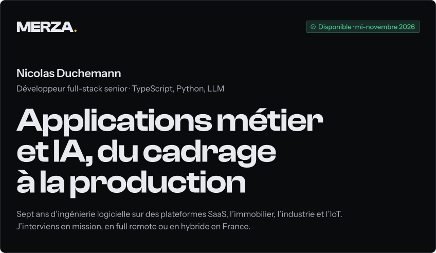

<!-- Généré par tools/build_readme.py. Modifier le script, pas ce fichier. -->

<a href="https://merza.fr"><picture><source media="(max-width: 600px)" srcset="assets/mobile/hero.svg"></picture></a>

<a href="https://meetings-eu1.hubspot.com/nicolas-duchemann"><picture><source media="(max-width: 600px)" srcset="assets/mobile/btn-call.svg"></picture></a>
<a href="https://merza.fr/realisations"><picture><source media="(max-width: 600px)" srcset="assets/mobile/btn-work.svg"></picture></a>

<a href="https://merza.fr/realisations"><picture><source media="(max-width: 600px)" srcset="assets/mobile/body.svg"></picture></a>

<a href="https://meetings-eu1.hubspot.com/nicolas-duchemann"><picture><source media="(max-width: 600px)" srcset="assets/mobile/contact.svg"></picture></a>

<a href="mailto:nicolas@merza.fr"><picture><source media="(max-width: 600px)" srcset="assets/mobile/btn-mail.svg"></picture></a>
<a href="https://merza.fr"><picture><source media="(max-width: 600px)" srcset="assets/mobile/btn-site.svg"></picture></a>
<a href="https://www.linkedin.com/in/nicolas-duchemann-91087510b/"><picture><source media="(max-width: 600px)" srcset="assets/mobile/btn-linkedin.svg"></picture></a>

